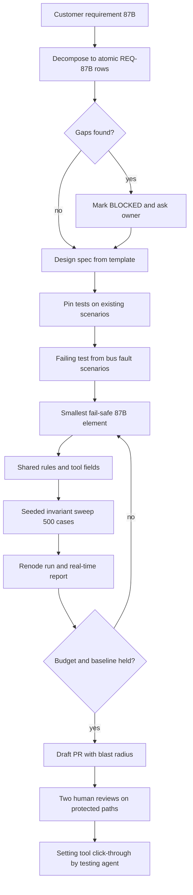

# Protection relay platform demo

A four-bay protection-relay firmware platform (STM32F407, 1920 Hz sampling, 480 Hz protection pass) with its setting tool, shared relay math, harness contract and safety discipline — set up as the day-zero repository for an agent to add a new ANSI 87B busbar-differential element from a flawed customer requirement.



Full flowchart: [docs/flowchart.html](docs/flowchart.html) · [docs/flowchart.png](docs/flowchart.png)

## What the demo shows

An agent receiving a realistic, imperfect busbar-differential requirement and carrying it through a traceable safety-critical SDLC on a real firmware platform: decomposition with explicit `BLOCKED` questions, design against platform figures, test-first implementation in C, validation on an emulated Cortex-M4 target with cycle budgets, settings validation shared between firmware and tool, and a draft PR that human reviewers gate. The 87B element does **not** exist on `main`; the platform, the test set, the conventions and the guard-rails do.

## What Devin does live

1. Reads `requirements/customer/87B-customer-requirement.md` and produces `docs/elements/87B/REQUIREMENTS.md` with atomic IDs, acceptance criteria and `BLOCKED` rows for every ambiguity.
2. Fills the design-spec template, citing `docs/platform/PLATFORM_FIGURES.md` and `OPEN_QUESTIONS.md`.
3. Follows `.agents/skills/safety-critical-change`: characterization tests, a failing test on `bus_fault_internal` / `bus_fault_external`, the element in `firmware/src/prot/`, rules in `shared/relay_math`, settings keys and a tool page.
4. Runs the host suite, the seeded invariant sweep, the STM32F407 build, Renode and the real-time report; compares before/after.
5. Opens a draft PR with the blast-radius statement; CI shows the two-reviewer gate; the testing agent click-tests the setting tool and attaches the recording.

## How the demo runs

```bash
make -C shared/relay_math all          # shared curve / per-unit / rules math + parity vectors
make -C firmware test                  # host test suites
make -C firmware/target/stm32f407      # Cortex-M4F image (arm-none-eabi-gcc)
python3 tools/run_renode.py --all      # secondary-injection scenarios on the emulated target
python3 tools/build_realtime_report.py # tool/public/realtime.json: budgets, scenarios, C37.118 compliance
make -C shared/relay_math wasm         # emsdk: same C compiled for the tool
cd tool && npm ci && npm run dev       # setting tool on http://localhost:3000
cd tool && npm run test:e2e            # Playwright gauntlet (5 journeys)
./firmware/build/sim/settings_write settings/relay.set 51P_TMS=0.01   # protocol-write bypass: rejected by the relay
```

Every step above runs inside a Devin session during the demo; see `DEMO_NOTES.md` for the flow and `harness.yaml` / `docs/HARNESS_CONTRACT.md` for what an external orchestrator needs.

## Repo layout

| Path | Contents |
|---|---|
| `firmware/include/ied_config.h`, `bay_config.h` | platform figures, 16-channel map, four-bay CT configuration |
| `firmware/src/rt`, `dsp`, `pmu` | acquisition ring, full-cycle DFT, mimic, IEEE C37.118 PMU |
| `firmware/src/prot`, `firmware/src/ied` | 50/51, 21, 50BF, 81 elements; trip logic; SOE; settings file parser |
| `firmware/testset` | analytic secondary-injection scenarios incl. `bus_fault_external`, `bus_fault_internal`, `ct_lost_bay1_load` |
| `firmware/tests`, `firmware/sim` | host suites; simulator; `settings_write` protocol-write bypass |
| `firmware/target/stm32f407` | bare-metal target, Renode platform |
| `shared/relay_math` | curve, per-unit and settings-rule C compiled into firmware and to WASM |
| `tool/` | Vite + React + TypeScript setting tool, Playwright journeys, `public/realtime.json` |
| `docs/platform` | figures, measurement chain, data model, performance-target template, open questions |
| `docs/standards`, `docs/templates`, `docs/elements/51` | coding standard, interface contracts, requirements convention, templates, 51 worked example |
| `requirements/customer` | the 87B requirement as received |
| `harness.yaml`, `docs/HARNESS_CONTRACT.md` | machine- and human-readable contract for an external Agentic SDLC mechanism |
| `.agents/skills/safety-critical-change` | mandatory change procedure |
| `.github/CODEOWNERS`, `.github/workflows/ci.yml`, `tools/check_*.py` | two-reviewer gate, failure-mode checks, traceability |

## Key concepts

- **Platform figures are code.** `ied_config.h` is the only source for rates, budgets and channel indices; docs and tests read it.
- **Invalid is not zero.** A missing or invalid channel blocks an element; it is never substituted. `tools/check_failure_modes.py` enforces it.
- **One math, two runtimes.** Curve equations and settings rules are compiled into the firmware and to WASM for the tool; `test_shared_parity` and the Playwright suite check both against the same vectors.
- **Atomic settings groups.** The relay re-validates every write and rejects the whole group on any rule violation, whichever path it came through.
- **Requirements with `BLOCKED` rows.** Gaps are questions for the owner, not defaults chosen by the implementer.
- **Evidence over plausibility.** Pinned tests, failing-test-first, ≥ 500-case seeded sweeps, before/after real-time report, blast-radius statement, two human reviews on protected paths.
